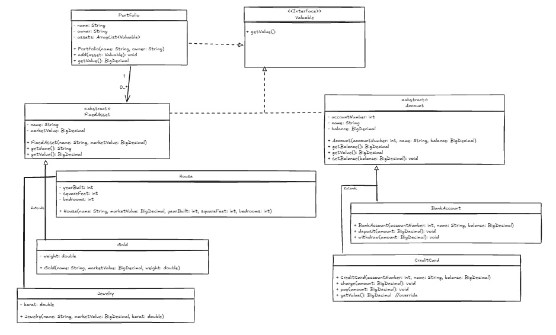

# Portfolio Manager

## Questions 

#### Did the deposit work for both accounts? Why or why not?
At first both deposits did not work because one had the Data Type/Class
of Valuable and the other one needed the correct data type argument.
#### What methods are available for account1?
The methods available for account1 is anything that is in the BankAccount Class.
#### What methods are available for account2?
The methods available for account2 is in Valuable which is only getValue.

#### Make Portfolio implement Valuable, like the finished diagram. Why does that make sense? what it lets a portfolio hold.
It makes sense because all items have a value but not every item is the same.
So, portfolio is able to implement valuable as the same as the other two parent classes.

## How to run it

1. Clone the repository and open it in IntelliJ
2. Run `App.java`

## Screenshots

## Author

Ruby Santos, Year Up Java Academy